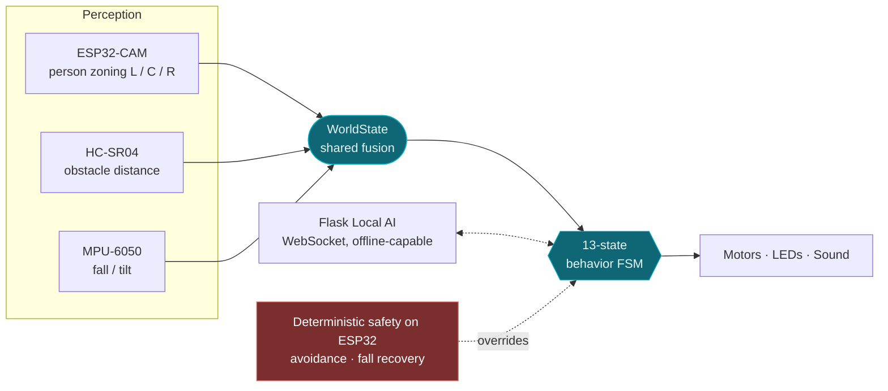

<p align="center">
  <a href="https://github.com/mzhnk">
    
  </a>
</p>

<h2 align="center">mzhnk</h2>

<p align="center">
  <sub><b>Software that has to keep working in the real world</b></sub>
</p>

<p align="center">
  
  
  
  
  
</p>

<p align="center">
  <a href="#about">About</a> ·
  <a href="#projects">Projects</a> ·
  <a href="#stack">Stack</a> ·
  <a href="#exploring">Exploring</a> ·
  <a href="#activity">Activity</a> ·
  <a href="#connect">Connect</a>
</p>

---

<a id="about"></a>
## About

I'm a student developer from Indonesia. Most of what I know comes from building real projects rather than following tutorials, usually at the point where software meets hardware and has to behave predictably in real time.

What I care about beyond "it works": how state is shared, how failures are handled, and what makes a system reliable enough to trust. I document the process as I go, because the failures teach more than the wins.

> [!NOTE]
> **Building in public.** Everything below is work in progress. I write down what broke as well as what worked.

```yaml
whoami:
  handle: mzhnk
  from: Indonesia
  role: student developer
  interests: [AI, web, embedded systems, robotics]
  building_now:
    - AI Pet Robot (V2, "Make It Aware")
    - 3D Periodic Table
  learning: [TypeScript, React, Next.js, Tailwind, PostgreSQL, Prisma, shadcn/ui, Zod]
  principle: "Failures teach more than wins. Document both."
```

---

<a id="projects"></a>
## Projects

### 🤖 AI Pet Robot · V2 "Make It Aware"

A desktop pet robot: an **ESP32 body** and a **Flask "Local AI" brain** talking over WebSocket. It's my way of learning embedded systems and sensor fusion by building something physical that has to keep working, not just something that compiles.



> [!IMPORTANT]
> **Safety is never delegated to the AI.** Obstacle avoidance and fall recovery are resolved deterministically on the ESP32. The Flask brain can suggest behavior, but it cannot override these decisions.

| Layer | What it does |
|:--|:--|
| **Perception** | Camera buckets people into left / center / right, ultrasonic measures obstacle distance, IMU catches falls and tilts |
| **Fusion** | All three sensor streams feed one shared `WorldState` |
| **Decision** | A 13-state FSM (curious → follow → interact → avoid → recover …) turns state into behavior |
| **Safety** | Obstacle avoidance and fall recovery are resolved deterministically **on the ESP32**, so the AI layer can never override them |
| **Resilience** | Base behaviors keep running if WiFi or the AI backend drops |

> [!WARNING]
> **Actively developed.** The V2 protocol is additive and still evolving, so expect changes between commits.

<details>
<summary><b>Version history: V1 → V2</b></summary>
<br>

| Version | Theme | Capabilities |
|:--|:--|:--|
| V1 | *Make It Alive* | Move, turn, react to touch |
| V2 | *Make It Aware* | See, sense distance, detect falls, decide |

</details>

<table>
  <tr>
    <td><b>Status</b></td>
    <td>Actively developed · additive V2 protocol · September 2026</td>
  </tr>
  <tr>
    <td><b>Verification</b></td>
    <td>
      
      
      
      
    </td>
  </tr>
  <tr>
    <td><b>Stack</b></td>
    <td><code>C++</code> <code>ESP32</code> <code>WebSocket</code> <code>Flask</code></td>
  </tr>
  <tr>
    <td><b>Repo</b></td>
    <td><a href="https://github.com/mzhnk/ai-pet-robot">github.com/mzhnk/ai-pet-robot</a></td>
  </tr>
</table>

<p align="center">
  <a href="https://github.com/mzhnk/ai-pet-robot">
    
  </a>
  <br>
  
  
</p>

<br>

### 🧪 3D Periodic Table

An interactive 3D visualization of all **118 elements** with four swappable layouts, smooth Anime.js transitions, and mouse, touch and long-press interaction, in English and Indonesian.

| Layouts | Interaction | Languages |
|:--:|:--:|:--:|
| Table · Sphere · Helix · Grid | Mouse · Touch · Long-press | EN · ID |

> [!NOTE]
> **Zero behavior change.** The refactor from a single 690-line `index.html` to 20 ES Modules was structural only.

**The refactor:** one 690-line `index.html` became 20 ES Module files, with zero behavior change.

```text
Before                          After
──────                          ─────
index.html  (690 lines)   ──▶   20 ES Modules
                                no bundler · no framework
                                i18n built into the component structure
```

- Pure CSS 3D transforms drive all four layout modes
- Modular ES Module architecture, nothing between the code and the browser
- Bilingual UI designed in from the start, not bolted on

<table>
  <tr>
    <td><b>Status</b></td>
    <td>Refactor shipped · September 2026</td>
  </tr>
  <tr>
    <td><b>Stack</b></td>
    <td><code>JavaScript</code> <code>ES Modules</code> <code>CSS3</code> <code>Anime.js</code></td>
  </tr>
  <tr>
    <td><b>Repo</b></td>
    <td><a href="https://github.com/mzhnk/periodic-table">github.com/mzhnk/periodic-table</a></td>
  </tr>
</table>

<p align="center">
  <a href="https://github.com/mzhnk/periodic-table">
    
  </a>
  <br>
  
  
</p>

---

<a id="stack"></a>
## Stack

> [!TIP]
> The left column is what I have **shipped** in real projects. The right column is what I am **still learning**.

<table>
  <tr>
    <th align="left" width="160">Domain</th>
    <th align="left">Shipped in real projects</th>
    <th align="left">Learning</th>
  </tr>
  <tr>
    <td><b>Languages</b></td>
    <td>
      
    </td>
    <td>
      
    </td>
  </tr>
  <tr>
    <td><b>Frontend</b></td>
    <td>
      
      
    </td>
    <td>
      
      
      
    </td>
  </tr>
  <tr>
    <td><b>Backend &amp; Data</b></td>
    <td>
      
      
    </td>
    <td>
      
    </td>
  </tr>
  <tr>
    <td><b>Embedded</b></td>
    <td>
      
      
      <br>
      <sub>ESP32-CAM · HC-SR04 · MPU-6050</sub>
    </td>
    <td><sub>Motor control, deeper sensor fusion</sub></td>
  </tr>
  <tr>
    <td><b>Testing &amp; Tooling</b></td>
    <td>
      
      
    </td>
    <td><sub>Type-safe application patterns</sub></td>
  </tr>
</table>

---

<a id="exploring"></a>
## Currently Exploring

> [!IMPORTANT]
> **Current priority:** moving from plain JavaScript toward the TypeScript and Next.js ecosystem, while keeping the embedded work going in parallel.

| Track | Focus | Why it matters to me |
|:--|:--|:--|
| **Modern web** | TypeScript, React, Next.js App Router, server actions, type-safe patterns | Moving from "it runs" to "the compiler catches my mistakes" |
| **Embedded & robotics** | State machines, sensor integration, motor control, real-time reliability | Physical systems punish sloppy assumptions |
| **Architecture** | ES Modules, design patterns, how the pieces fit beneath the framework | Frameworks change; structure carries over |

---

<a id="activity"></a>
## Activity

<p align="center">
  
  <picture>
    <source media="(max-width: 480px)" srcset="https://github-readme-stats.shion.dev/api/top-langs/?username=mzhnk&layout=compact&theme=dark&hide_border=false&langs_count=5&title_color=00AFC2&text_color=8B949E&icon_color=00AFC2&bg_color=0D1117&border_color=164A55&border_radius=10" />
    
  </picture>
</p>

<p align="center">
  
</p>

<p align="center">
  
</p>

---

<a id="connect"></a>
## Connect

> [!TIP]
> Happy to talk about embedded systems, robotics, or web architecture. Email is the best way to reach me.

<p align="center">
  <a href="https://github.com/mzhnk"></a>
  <a href="mailto:zihankholidi@gmail.com"></a>
  <a href="https://www.linkedin.com/in/mzhnk"></a>
  <a href="https://instagram.com/mzkx2201"></a>
</p>

---

<p align="center">
  <i>Consistency over talent, building in public, one commit at a time.</i><br>
  <sub>재능보다 꾸준함, 한 번에 한 커밋씩.</sub>
</p>


